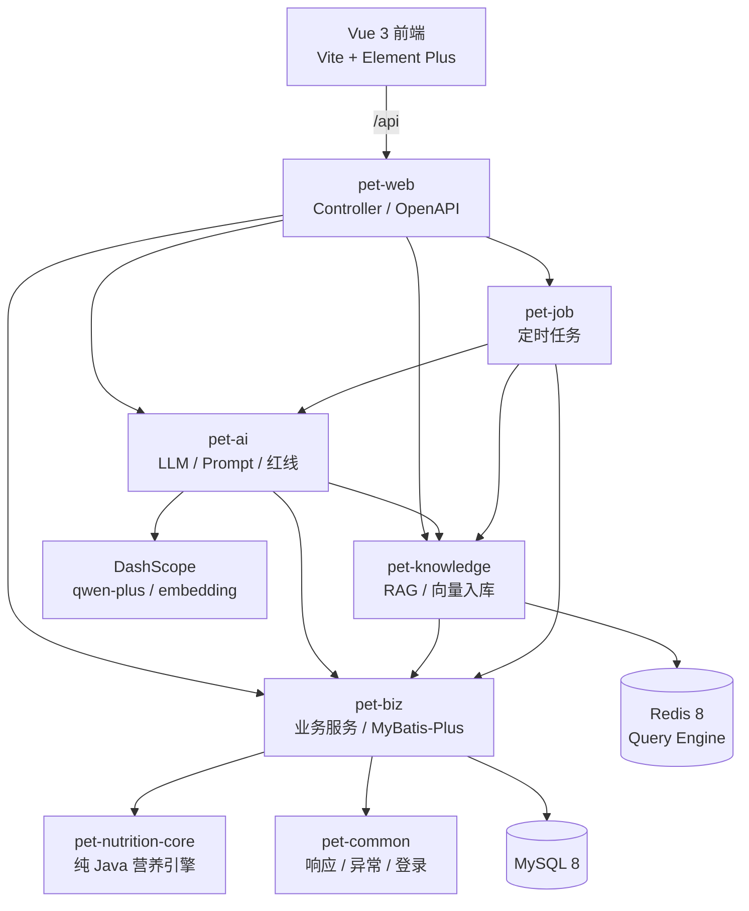

# FurGuardian · 养宠智能助手

把「经验喂养」变成「数据喂养」。

FurGuardian 面向犬猫主人，用确定性的营养算法回答「每天到底喂多少」，用国标逐项判定主粮营养是否达标，再结合经来源标注与入库筛选的知识库与大模型生成每日 Tip、每日食谱、知识问答和周报。

> 本项目是日常营养管理与健康趋势追踪工具，不是兽医诊疗系统。AI 生成内容仅供参考，不构成医疗建议。

## 目录

- [核心功能](#核心功能)
- [技术栈](#技术栈)
- [系统架构](#系统架构)
- [快速开始](#快速开始)
- [关键配置](#关键配置)
- [营养计算规则](#营养计算规则)
- [知识库与 RAG](#知识库与-rag)
- [定时任务](#定时任务)
- [API 一览](#api-一览)
- [目录结构](#目录结构)
- [测试与构建](#测试与构建)
- [部署](#部署)
- [数据来源与安全边界](#数据来源与安全边界)
- [已知限制](#已知限制)
- [常见问题](#常见问题)
- [数据来源参考](#数据来源参考)

## 核心功能

| 模块 | 能力 |
| --- | --- |
| 账号与宠物档案 | 注册 / 登录 / 登出；多宠物；品种、生日、绝育、活动量、生理状态；插画头像；BCS 9 分制与 WSAVA 参考图 |
| 体重管理 | 体重时序记录、趋势曲线、BCS 同步记录，为营养计算和周报提供数据 |
| 个体化营养方案 | RER / MER 计算、超重按理想体重修正、每日主粮克数与餐次、零食 10% 热量上限、完整计算过程展示 |
| 营养达标判定 | 干物质基准换算，对照 GB/T 31216-2014（犬粮）和 GB/T 31217-2014（猫粮）校验蛋白质、脂肪、钙、磷、牛磺酸（猫）、赖氨酸（犬） |
| 食品库 | 食品增删改查、保证值录入、猫犬适用性校验、零食与主粮区分、代谢能标注或公式估算 |
| 每日 Tip | SSE 流式生成、知识库 RAG、Redis 缓存、换一条、点赞 / 点踩、紧急症状红线拦截 |
| 知识问答 | `review_status=approved` 语料检索、向量检索 + SQL 降级、逐条引用来源、会话历史 / 重命名 / 删除 / 导出 Markdown |
| 每日食谱建议 | 在确定性营养结果之上，结合零食库与知识库由 LLM 生成可执行食谱；AI 不可用时返回确定性兜底建议 |
| 提醒管理 | 每天 / 每周 / 每月 / 每年 / 单次提醒、打卡、近 7 天时间轴、连续打卡与完成率统计 |
| 周度报告 | 规则引擎生成结构化结论，AI 仅负责润色措辞；体重趋势与 BCS 变化联动 |

几个设计取舍：

- **数字不交给大模型**：热量、克数、餐次、营养判定全部来自确定性算法，LLM 只能在这些结果之上组织语言。
- **AI 不编造知识**：Prompt 明确要求只使用参考资料中的信息；知识库没有覆盖的食材剂量，禁止生成具体克数或频次。
- **检索失败不阻断业务**：向量检索异常或未命中时自动降级为 SQL 关键词检索。
- **紧急情况优先**：命中抽搐、呼吸困难、尿闭、中毒等红线关键词时，直接返回就医提示，不进入 LLM。

## 技术栈

### 后端

| 类别 | 选型 |
| --- | --- |
| 语言 / 运行时 | Java 21 |
| 框架 | Spring Boot 4.1.1（Spring MVC） |
| 持久层 | MyBatis-Plus 3.5.17（Boot 4 starter） |
| 数据库 | MySQL 8.0 |
| 缓存 / 向量库 | Redis 8.x（Query Engine，`FT.CREATE` / `FT.SEARCH`） |
| AI 编排 | LangChain4j 1.22.0（community 1.22.0-beta32） |
| 模型服务 | 阿里云百炼 DashScope：`qwen-plus` + `text-embedding-v3`（1024 维） |
| 接口文档 | SpringDoc OpenAPI 3.1.1 |
| 测试 | JUnit 5 |

### 前端

| 类别 | 选型 |
| --- | --- |
| 框架 | Vue 3.5 + TypeScript 5.7 |
| 构建 | Vite 6 |
| 状态 / 路由 | Pinia 3、Vue Router 4 |
| UI / 图表 | Element Plus 2.9、ECharts 5.6、lucide-vue-next |
| 请求 | Axios |
| 内容渲染 | marked + DOMPurify（Markdown 安全渲染） |
| 时间处理 | dayjs |

### 基础设施

- Docker Compose：MySQL 8.0 + Redis 8
- Maven Wrapper 3.9.4，无需预装 Maven

## 系统架构



### 模块职责

| 模块 | 职责 |
| --- | --- |
| `pet-common` | 统一响应体、错误码、业务异常、用户上下文、登录拦截器、CORS、Redis 配置 |
| `pet-nutrition-core` | RER / MER、干物质换算、国标标准、能量估算、危险食材规则；**不依赖 Spring / MyBatis / LangChain4j**，可独立测试 |
| `pet-biz` | 领域实体、Mapper、账号 / 宠物 / 食品 / 营养 / 提醒 / 周报 / Tip / 会话等业务服务 |
| `pet-knowledge` | Redis 8 向量检索、Embedding 入库、`approved` 状态过滤、SQL 关键词降级 |
| `pet-ai` | LLM 调用封装、Prompt 模板、Tip 生成、每日食谱、周报润色、红线匹配 |
| `pet-job` | 每日 Tip 推送、周报生成、知识向量入库 |
| `pet-web` | Spring Boot 启动类、REST Controller、DTO、运行配置 |
| `fur-guardian-front` | Vue 3 单页应用 |

依赖方向大致为：`pet-web → pet-ai / pet-job / pet-knowledge / pet-biz → pet-nutrition-core / pet-common`。`pet-nutrition-core` 保持零框架依赖，营养算法可以脱离整个应用单独运行和测试。

### 一次知识问答的链路

1. 前端把问题提交到 `POST /api/ai/query`。
2. 先做红线关键词检测；命中则直接返回「尽快就医」提示。
3. 根据宠物物种和生命阶段，从 `knowledge_docs` 中取出 `review_status=approved` 且非急诊的候选集合。
4. 优先用 Redis 向量检索召回；异常或无命中时降级为 SQL 关键词检索（中文按双字滑窗切分）。
5. 把命中的知识条目作为唯一参考资料拼进 Prompt，调用 `qwen-plus`。
6. 返回回答和来源列表；前端展示可点击的引用，并把这一轮问答落库到会话。

## 快速开始

### 环境要求

| 组件 | 要求 |
| --- | --- |
| JDK | 21 或更高（项目以 Java 21 编译） |
| Node.js | 20 或更高（Vite 6） |
| MySQL | 8.0+ |
| Redis | **8.0+**，必须带 Query Engine；Redis 7 没有 `FT.CREATE` / 向量检索 |
| DashScope | 可选。没有 API Key 时，AI 相关功能走兜底逻辑，知识向量入库任务会跳过 |

Maven 不需要单独安装，仓库自带 `mvnw` / `mvnw.cmd`。

### 1. 启动 MySQL 与 Redis

```bash
git clone https://github.com/yizqq0721/GurGuardian.git
cd GurGuardian

cp .env.example .env
# 编辑 .env，替换三个 CHANGE_ME 密码
docker compose up -d
docker compose ps
```

首次启动时，MySQL 会按固定顺序执行 `schema.sql` → `seed.sql` → `knowledge_seed.sql` → `knowledge_seed_wsava.sql` → `knowledge_seed_msd.sql`（容器内映射为 `01/02/03/04/05`），创建 15 张表，并写入演示账号、2 只宠物、7 条提醒、3 款食品和 1340 条知识语料。

> 初始化 SQL 只在数据卷为空时执行一次。修改 `sql/*.sql` 后要重新初始化，必须 `docker compose down -v`（会删除数据）。

如果使用机器上已有的 MySQL / Redis，请手动按顺序导入：

```bash
mysql --default-character-set=utf8mb4 -uroot -p < sql/schema.sql
mysql --default-character-set=utf8mb4 -uroot -p fur_guardian < sql/seed.sql
mysql --default-character-set=utf8mb4 -uroot -p fur_guardian < sql/knowledge_seed.sql
mysql --default-character-set=utf8mb4 -uroot -p fur_guardian < sql/knowledge_seed_wsava.sql
mysql --default-character-set=utf8mb4 -uroot -p fur_guardian < sql/knowledge_seed_msd.sql
```

确认 Redis 具备向量能力：

```bash
docker exec pet-redis redis-cli -a "$REDIS_PASSWORD" INFO server | grep redis_version
docker exec pet-redis redis-cli -a "$REDIS_PASSWORD" FT._LIST
```

`FT._LIST` 返回空列表也算正常（索引会在首次写入向量时自动创建）；如果报 `unknown command`，说明 Redis 版本不对。

### 2. 配置后端

```bash
cp pet-web/src/main/resources/application-local.yml.example \
   pet-web/src/main/resources/application-local.yml
```

编辑 `application-local.yml`：

- MySQL / Redis 地址与密码
- DashScope API Key（chat 与 embedding 两处都要填）
- 如果 MySQL / Redis 就跑在本机 Docker 的默认端口，把模板里的 **3307 / 6380 改成 3306 / 6379**；模板默认按 SSH 隧道端口编写

`application-local.yml` 已被 `.gitignore` 排除，不会进仓库。`application.yml` 默认激活 `local` profile。

### 3. 启动后端

```bash
./mvnw -DskipTests package
java -jar pet-web/target/pet-web-0.0.1-SNAPSHOT.jar
```

Windows 下把 `./mvnw` 换成 `mvnw.cmd`。也可以在 IDE 中直接运行 `com.purr.furguardian.FurGuardianApplication`。

后端默认监听 `http://localhost:8080`。

### 4. 启动前端

```bash
cd fur-guardian-front
npm install
npm run dev
```

打开 `http://localhost:5173`。Vite 已配置把 `/api` 代理到 `http://localhost:8080`。

生产构建：

```bash
npm run build
```

### 5. 演示账号

| 账号 | 密码 |
| --- | --- |
| `demo` | `123456` |

种子数据包含一只玩具贵宾「豆豆」和一只英短「咪咪」，以及 8 周体重记录；也可以直接注册新账号从 4 步引导开始建档。

### 6. 首次向量入库

知识语料先写入 MySQL，再由定时任务写入 Redis 向量索引：

- 默认每天 03:00 执行，只处理 `embedding_id` 为空的条目。
- 想在启动后立即验证 RAG，可在 `application-local.yml` 中临时加快 cron：

```yaml
fur-guardian:
  job:
    embedding-ingest-cron: "0 0/5 * * * ?"
```

- 没有配置 DashScope Key 时任务会跳过，问答自动走 SQL 关键词检索，功能仍可用但召回质量下降。

## 关键配置

主要配置文件：

- `pet-web/src/main/resources/application.yml`：公共配置与占位符
- `pet-web/src/main/resources/application-local.yml`：本地真实密码与 Key，**不入库**
- `.env`：Docker Compose 的 MySQL / Redis 密码，**不入库**

几个容易踩的点：

| 配置 | 说明 |
| --- | --- |
| `spring.datasource.url` | `characterEncoding` 必须写 `UTF-8`。Connector/J 9.x 不认识 `utf8mb4` 这个名称，服务端仍会落到 utf8mb4 |
| `spring.data.redis.*` | 登录 Token 与会话缓存使用的 Redis |
| `langchain4j.community.redis.*` | LangChain4j 的向量库 Redis，**与上面不是同一套 Bean**，两处必须指向同一个 Redis，否则会出现「能登录但 RAG 不可用」 |
| `langchain4j.community.redis.metadata-keys` | 必须显式声明 `docId`、`species`、`lifeStage`、`severity`。未声明的 metadata 回读时会被丢弃，向量检索会静默命中 0 条并降级 SQL |
| `langchain4j.community.redis.dimension` | `1024`，与 `text-embedding-v3` 输出维度一致 |
| `langchain4j.community.dashscope.*` | 对话模型与向量模型分别配置；两处都要填同一个 DashScope Key |

## 营养计算规则

`pet-nutrition-core` 中的 `NutritionCalculator` 是整套系统的数字来源。

```text
RER = 70 × 体重(kg)^0.75
MER = RER × 生命阶段系数 × 绝育系数 × 活动量系数 × 生理状态系数

BCS 6-9：理想体重 = 当前体重 ÷ (1 + 0.1 × (BCS - 5))，用理想体重计算
BCS ≤ 3：按当前体重计算，MER 额外上调 15%

零食上限 = MER × 10%
每日主粮热量 = MER - 零食上限
每日主粮克数 = 每日主粮热量 ÷ (能量密度 kcal/100g ÷ 100)
```

其他规则：

- 幼犬 / 幼猫每天 3 餐，其余 2 餐。
- 食品标注了代谢能时直接使用；没有标注时用修正 Atwater 公式估算，高纤维粮改用 AAFCO 公式。
- 干粮和湿粮统一换算到干物质基准再比较：`干物质百分比 = 标注值 ÷ (100 - 水分) × 100`。
- 零食不能当作主粮参与计算；猫犬物种不匹配的食品会被拒绝。
- 危险食材名单包含洋葱、大蒜、葡萄 / 葡萄干、巧克力、木糖醇、酒精、澳洲坚果、咖啡因、生面团等，命中时给出警告。
- 超重减重速率提示：猫不超过 1%/周，犬不超过 1.5%/周。

## 知识库与 RAG

### 语料

| 文件 | 内容 |
| --- | --- |
| `sql/knowledge_seed.sql` | 80 条基础养宠知识 |
| `sql/knowledge_seed_wsava.sql` | 由 WSAVA 全球营养指南中文摘要切分的 765 条语料，单条不超过 1200 字 |
| `sql/knowledge_seed_msd.sql` | 由 MSD 兽医手册中文摘要切分的 495 条语料，单条不超过 1200 字 |
| `sql/build-wsava-seed.mjs` | 生成 WSAVA 种子 SQL 的脚本 |
| `sql/build-msd-seed.mjs` | 生成 MSD 种子 SQL 的脚本 |

合计 **1340 条**，均已入库并完成向量化；其中 60 条严重等级为 `emergency` 的条目被检索规则排除，实际参与问答检索的为 **1280 条**。每条语料包含标题、正文、物种、生命阶段、主题、严重等级、来源名称 / 类型 / URL、审核状态等字段。

### 检索策略

1. 只检索 `review_status = approved` 且严重等级不是 `emergency` 的条目。
2. 按宠物物种和生命阶段过滤候选集合。
3. 用 `text-embedding-v3` 生成 1024 维向量，在 Redis 8 中做余弦相似度检索，`minScore = 0.3`。
4. 通过 metadata 中的 `docId` 回 MySQL 校验审核状态，避免向量库与业务库不一致。
5. 向量检索异常或没有命中时，降级为 SQL 关键词检索。中文没有分词器，使用双字滑窗提取关键词。

### 向量索引

- 索引名：`fur-guardian-embeddings`
- 维度：`1024`
- LangChain4j 在首次 `add()` 时自动创建索引；手动创建参考见 `sql/knowledge_vector_index.sql`
- 定时入库默认每天 03:00，只处理尚未入库的条目

## 定时任务

| 任务 | 默认时间 | 说明 |
| --- | --- | --- |
| `TipPushJob` | 每天 07:00 | 为所有宠物生成当日 Tip |
| `WeeklyReportJob` | 每周一 08:00 | 生成上周周报并调用 AI 润色 |
| `KnowledgeEmbeddingJob` | 每天 03:00 | 把未入库的知识条目写入 Redis 向量索引；cron 可通过 `fur-guardian.job.embedding-ingest-cron` 覆盖 |

任务使用 Spring `@Scheduled`，没有分布式锁。部署多个后端实例时会给同一只宠物重复生成 Tip / 周报，需要自行加锁或只启用一个调度实例。

## API 一览

- 统一响应：`{ "code": 200, "message": "ok", "data": ... }`
- 鉴权：除登录、注册和 Swagger 外，`/api/**` 都要求 `Authorization: Bearer <token>`
- Token 存在 Redis，有效期 7 天
- Swagger UI：`http://localhost:8080/swagger-ui.html`
- OpenAPI JSON：`http://localhost:8080/v3/api-docs`

| 领域 | 主要接口 |
| --- | --- |
| 账号 | `POST /api/auth/register`、`/login`、`/logout` |
| 宠物 | `POST /api/pet`、`PUT/DELETE /api/pet/{id}`、`GET /api/pet/{id}`、`/list`、`POST /{id}/weight`、`GET /{id}/weight-history` |
| 食品 | `POST /api/food`、`PUT/DELETE /api/food/{id}`、`GET /api/food/{id}`、`/{id}/nutrients`、`/list` |
| 营养 | `GET /api/nutrition/calculate?petId=&foodId=`、`GET /api/nutrition/recipe?petId=&foodId=` |
| 提醒 | `POST /api/reminder`、`PUT/DELETE /api/reminder/{id}`、`GET /list`、`POST /{id}/checkin`、`GET /logs` |
| 周报 | `POST /api/report/generate`、`GET /api/report/list`、`GET /{id}`、`/{id}/conclusions`、`POST /{id}/polish`、`GET /{id}/summary` |
| Tip | `GET /api/tip/stream`（SSE）、`/today`、`/history`、`POST /{tipId}/feedback`、`POST /check-redline` |
| AI 问答 | `POST /api/ai/query`、`GET /api/ai/search` |
| 知识会话 | `GET/POST /api/knowledge/chats`、`PUT/DELETE /api/knowledge/chats/{id}`、`GET/POST /api/knowledge/chats/{id}/messages` |

## 目录结构

```text
.
├── pom.xml                      # Maven 父 POM
├── pet-common/                  # 通用响应、异常、登录拦截、Redis
├── pet-nutrition-core/          # 纯 Java 营养计算引擎
├── pet-biz/                     # 实体、Mapper、业务服务
├── pet-knowledge/               # RAG 检索与向量入库
├── pet-ai/                      # LLM、Prompt、Tip、食谱、周报润色
├── pet-job/                     # 定时任务
├── pet-web/                     # 启动类、Controller、运行配置
├── fur-guardian-front/          # Vue 3 前端
│   ├── src/api/                 # Axios 接口封装
│   ├── src/components/          # 通用组件（BCS、体重图、TipCard 等）
│   ├── src/composables/         # SSE 等组合式逻辑
│   ├── src/layouts/             # 应用布局
│   ├── src/stores/              # Pinia 状态
│   └── src/views/               # 页面
├── sql/
│   ├── schema.sql               # 15 张表
│   ├── seed.sql                 # 演示账号、宠物、体重、食品、提醒
│   ├── knowledge_seed.sql       # 80 条基础知识
│   ├── knowledge_seed_wsava.sql # 765 条 WSAVA 语料
│   ├── knowledge_seed_msd.sql   # 495 条 MSD 兽医手册语料
│   └── knowledge_vector_index.sql
├── deploy/                      # 云服务器部署说明与修复脚本
├── docs/                        # 食材营养数据来源等补充文档
├── docker-compose.yml           # MySQL + Redis
└── .env.example                 # Compose 环境变量模板
```

### 数据表

- 用户与宠物：`users`、`pets`、`pet_profiles_ext`、`pet_weight_logs`
- 食品与喂养：`foods`、`food_nutrients`、`feeding_plans`、`feeding_logs`
- 提醒：`reminders`、`reminder_logs`
- 内容：`tips`、`weekly_reports`
- 知识库：`knowledge_docs`、`knowledge_chat_sessions`、`knowledge_chat_messages`

## 测试与构建

```bash
# 后端：编译 + 单元测试
./mvnw test

# 后端：打包
./mvnw -DskipTests package

# 前端：类型检查 + 生产构建
cd fur-guardian-front
npm run build
```

当前自动化测试覆盖营养计算引擎的核心规则，以及 Spring Boot 上下文启动。前端目前没有单元测试 / E2E 测试，`npm run build` 会先执行 `vue-tsc --noEmit` 做类型检查。

## 部署

仓库中的 `docker-compose.yml` 只负责 MySQL 和 Redis，后端与前端需要分别部署。云服务器上的完整步骤、SSH 隧道连接方式和故障排查见：

- [deploy/云服务器部署说明.md](deploy/云服务器部署说明.md)

生产环境的基本流程：

```bash
# 后端
./mvnw -DskipTests package
java -jar pet-web/target/pet-web-0.0.1-SNAPSHOT.jar

# 前端
cd fur-guardian-front
npm ci
npm run build
```

把 `fur-guardian-front/dist` 交给 Nginx 等静态服务器托管，并把 `/api` 反向代理到后端 `8080`。仓库没有内置 Nginx 配置，需要按实际域名和端口自行编写。

部署注意：

- 3306 / 6379 不要直接对 `0.0.0.0/0` 开放，优先使用 SSH 隧道或安全组白名单。
- Redis 必须是 8.x；Docker Compose 中使用了带 Query Engine 的镜像。如果镜像拉取失败，换用可用的 Redis 8 镜像后重新确认 `FT._LIST`。
- `.env`、`application-local.yml` 和日志文件都已在 `.gitignore` 中排除。

## 数据来源与安全边界

营养规则参考 WSAVA Global Nutrition Guidelines、GB/T 31216-2014、GB/T 31217-2014、NRC 与美国饲料管理官员协会（AAFCO）标准，完整来源清单、法规链接与署名要求见文末 [数据来源参考](#数据来源参考)。

安全边界：

- 密码使用 BCrypt 存储；登录令牌存放在 Redis，7 天过期。
- 知识问答只使用 `review_status=approved` 且非急诊的语料，并附来源。
- AI Prompt 禁止使用「诊断」「处方」「治疗」「确诊」等医疗术语，输出需附免责声明。
- 命中紧急症状红线时直接提示就医，不依赖模型判断。
- 危险食材规则在营养引擎层拦截并告警。
- 所有 AI 结果仅供参考，不能替代兽医面诊。

## 已知限制

- **没有数据库迁移工具**：表结构变更靠手工 SQL，初始化脚本只对空数据卷执行一次。
- **定时任务单实例假设**：多实例部署会重复执行 Tip、周报和向量入库。
- **向量入库没有手动入口**：目前依赖定时任务；首次启动后要立即获得最佳召回效果，需要临时调整 cron 或等待 03:00。
- **知识覆盖不完整**：猪肝、鸡心等具体食材的每 100g 营养数据尚未收录，AI 会遵守「不编造剂量」约束，给出的建议偏保守。
- **前端测试不足**：目前只有类型检查和生产构建，没有组件测试与端到端测试。
- **AI 可用性依赖外部服务**：DashScope 超时或未配置 Key 时，Tip、食谱、周报摘要会走兜底或跳过，不影响营养计算与数据管理。

## 常见问题

| 现象 | 处理 |
| --- | --- |
| `unknown command 'FT._LIST'` | Redis 版本低于 8.0，没有 Query Engine；换 Redis 8 镜像并确认版本 |
| 容器起来了但表是空的 | 初始化 SQL 只在数据卷为空时执行；`docker compose down -v` 后重新启动（会删数据） |
| 能登录但知识问答一直走 SQL | 两套 Redis 配置不一致，或 `metadata-keys` 漏了 `docId`；确认 `langchain4j.community.redis` 与 `spring.data.redis` 指向同一实例 |
| 向量索引一直为空 | 没有配置 DashScope embedding Key，或入库任务还没执行；检查日志中的跳过提示并确认 cron |
| AI 一直返回兜底内容 | 检查 DashScope Key、余额、模型名和网络；后端日志会记录超时或调用失败 |
| 中文变问号 / 西欧乱码 | 命令行导入时加 `--default-character-set=utf8mb4`；JDBC URL 保留 `characterEncoding=UTF-8`。已产生的双重编码数据可用 `deploy/fix-mojibake-utf8mb4.sql` 修复 |
| 前端 401 | Token 过期（7 天）或 Redis 中的登录态被清空，重新登录即可 |

## 数据来源参考

营养计算、营养达标判定与知识库内容的主要依据如下。完整清单、各板块链接、语料落地情况与版权署名要求见 [查看更多：完整数据来源与 WSAVA 资料清单 →](docs/数据来源参考.md)。

### WSAVA（核心依据）

- **WSAVA Global Nutrition Guidelines / GNC Toolkit**：营养评估（第五生命体征）、BCS / MCS、RER / DER、住院喂养、选粮、零食 10% 原则、生肉基饮食、互联网营养信息评估。见 [营养指南](https://wsava.org/global-guidelines/global-nutrition-guidelines/) 与 [营养工具包](https://wsava.org/nutrition-toolkit)。
- **WSAVA 全球指南 11 个板块**：动物福利、牙科、胃肠、遗传病、肝病、微芯片、疼痛、职业健康、肾病、生殖控制、疫苗接种。见 [WSAVA Global Guidelines](https://wsava.org/global-guidelines/)。
- **《推进小动物营养六大关键原则》**：营养文化、团队角色、风险评估、快速干预与监测、营养沟通、出院教育。
- 知识库共收录 1340 条语料：765 条由 WSAVA 营养指南与工具包整理，495 条由 MSD 兽医手册中文摘要整理；每条附来源名称与链接。

> WSAVA 内容的翻译与对外引用受 GNC SOP v4 约束：需先申请、整份翻译、保留 GNC Logo、附指定英文署名声明；BCS / MCS 图表另需版权人单独授权。

### 中国国家标准与法规

- GB/T 31216-2014《全价宠物食品 犬粮》
- GB/T 31217-2014《全价宠物食品 猫粮》
- 农业农村部公告第 20 号（2018）：《宠物饲料管理办法》《宠物饲料标签规定》《宠物饲料卫生规定》

### 国际标准与营养需求

- NRC《Nutrient Requirements of Dogs and Cats》(2006)
- AAFCO 犬猫营养 profiles
- FEDIAF Nutritional Guidelines

### 食材成分数据

- USDA FoodData Central
- 中国食物成分表（第 6 版）
- 日本食品标准成分表（八订）
- FAO/INFOODS

当前知识库尚未收录猪肝、鸡心等具体食材的每 100 g 数值，补录格式与数据缺口见 [docs/food-nutrition-data-sources.md](docs/food-nutrition-data-sources.md)。

### 临床与安全参考

- Merck Veterinary Manual（MSD 兽医手册中文摘要，495 条已入库；仅作内部研发与检索验证，不对外分发）
- AAHA / AAFP / ISFM / CAPC / ESCCAP 指南
- 《宠物饲料卫生规定》

[查看更多：完整数据来源、法规链接、WSAVA 资料清单与署名要求 →](docs/数据来源参考.md)
