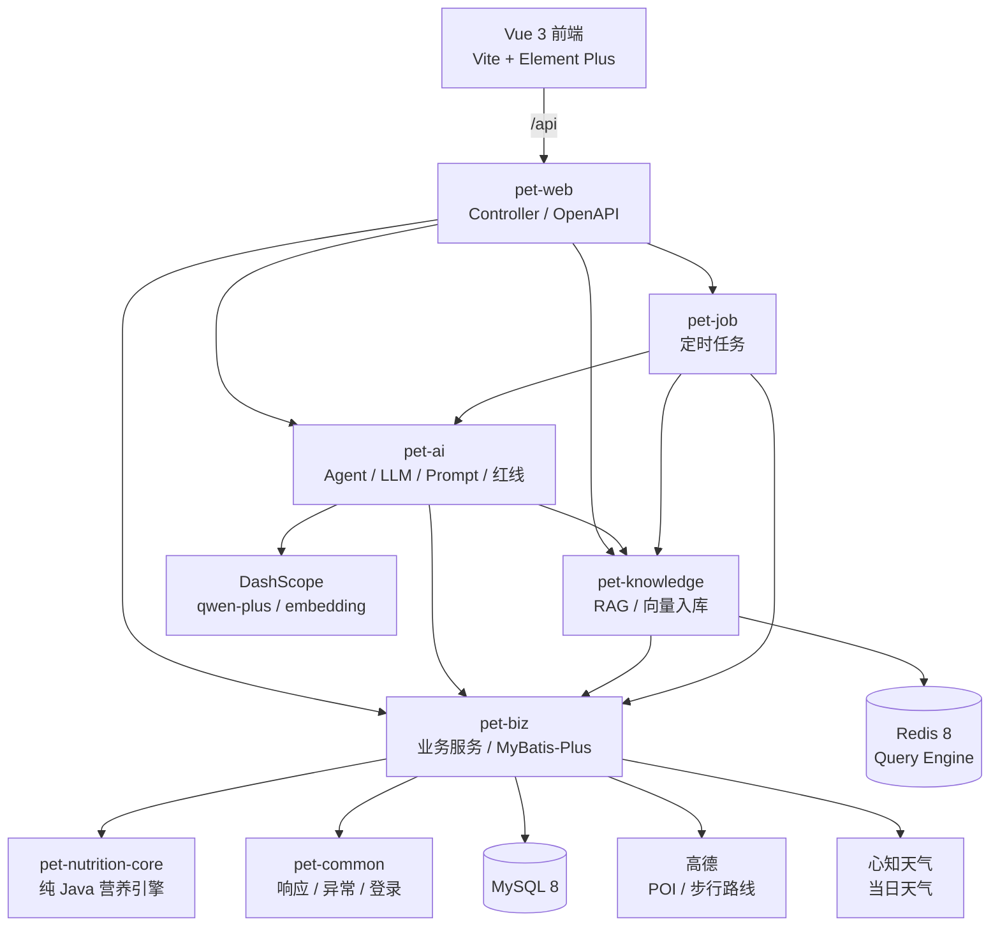

# FurGuardian 养宠智能助手 · 系统介绍

> 用途：本文是一份可直接交给 GPT 的项目背景资料，用于撰写比赛介绍、答辩稿、PPT 文案或项目总结。
> 更新时间：2026-10-25
> 线上地址：https://47.98.17.243 （HTTPS，可直接访问演示）

---

## 1. 项目是什么

**一句话：** FurGuardian 把「凭经验喂宠」变成「按数据喂养」——用确定性营养算法算清每天该喂多少，用经来源标注与入库筛选的知识库约束大模型，再用工具型 Agent 结合宠物真实数据回答「这周照顾得怎么样」。

**产品定位：** 面向犬猫主人的日常营养管理与健康趋势追踪工具。

**明确边界：** 不是兽医诊疗系统，不做诊断、处方、治疗；AI 回答仅供参考，发现异常只建议观察或就医。

**解决的三个真实痛点：**

1. **喂多少说不清**：不同品种、年龄、绝育状态、活动量、体况对应的热量差异很大，网上答案互相矛盾。
2. **信息记不住、坚持不了**：疫苗、驱虫、喂食、遛弯散落在聊天记录和备忘录里，漏做没人提醒。
3. **不敢信 AI**：通用大模型会编造剂量和结论；宠物健康场景一旦编错，代价很高。

**对应的三个设计原则：**

- **数字不交给大模型**：热量、克数、餐次、营养达标判定全部由确定性算法计算。
- **AI 不编造知识**：回答只允许使用知识库检索结果与工具返回的真实数据，并附来源。
- **高风险操作必须人确认**：AI 只能生成「待确认计划」，用户点确认后才写入数据库。

---

## 2. 核心功能

> 下表是系统的完整能力，均已包含在 2026-10-25 19:25 的上线版本中；逐项验证情况见 5.2。

| 模块 | 能力 |
| --- | --- |
| 账号与宠物档案 | 注册 / 登录 / 登出；多宠物；品种、生日、绝育、活动量、生理状态；BCS 9 分制与参考图；系统头像或上传头像 |
| 体重管理 | 体重时序记录、趋势曲线、BCS 同步记录，为营养计算与周报提供数据 |
| 个体化营养方案 | RER / MER 计算、超重按理想体重修正、每日主粮克数与餐次、零食 10% 热量上限、完整计算过程展示 |
| 营养达标判定 | 干物质基准换算，对照 GB/T 31216-2014（犬粮）与 GB/T 31217-2014（猫粮），校验蛋白质、脂肪、钙、磷、牛磺酸（猫）、赖氨酸（犬） |
| 食品库 | 食品增删改查、保证值录入、猫犬适用性校验、主粮 / 零食区分、代谢能标注或公式估算 |
| 每日 Tip | SSE 流式生成、知识库检索、Redis 缓存、换一条、点赞 / 点踩、紧急症状红线拦截 |
| 每日食谱建议 | 在确定性营养结果之上，结合零食库与知识库生成可执行食谱；AI 不可用时返回确定性兜底 |
| 提醒管理 | 每天 / 每周 / 每月 / 每年 / 仅一次；疫苗、驱虫按计划日期只提醒一次；打卡、近 7 天时间轴、完成率与连续打卡 |
| 待办日历 | 按日期聚合提醒与到期事件 |
| 周度报告 | 规则引擎生成结构化结论，AI 只负责润色与小结；体重趋势与 BCS 变化联动 |
| **知识问答 Agent** | 6 个工具、最多 3 轮工具调用、最近 8 条对话上下文、逐条引用来源、会话历史 / 重命名 / 删除 / 导出 Markdown |
| **周度照护复盘（双 Agent）** | 照护分析 Agent 只读体重 / 喂食 / 提醒 / 档案并识别数据缺口；行动计划 Agent 没有数据工具，只能基于分析结论检索知识并生成待确认提醒；两个角色独立提示词与工具集，固定顺序执行，共用 45 秒预算 |
| 回答反馈 | 每条 AI 回答可标「有用 / 没用」；反馈汇总为有用率与最近差评，形成质量闭环 |
| 周边资源 | 高德 POI 查询附近宠物医院与公园、步行路线规划、逆地理编码；遛弯提醒可直接跳转 |
| 天气 | 按用户常用城市查询当日天气；遛弯提醒展示天气，不申请浏览器定位 |
| 用户中心 | 昵称、常用城市、头像等资料维护 |
| 管理后台 | 管理员查看用户列表 / 详情、启用 / 禁用账号 |
| 多端 | 响应式 Web（375 / 768 / 1280 实测）、Android debug APK（Capacitor 远程壳）、HarmonyOS NEXT HAP（ArkTS Web 壳，已在真机使用） |

**知识问答 Agent 的典型问题：**

- 「我家狗这周照顾得怎么样？有没有漏做的事？」→ 依次查体重、喂食打卡、提醒状态后综合回答。
- 「帮我下周三上午九点建一个狂犬疫苗提醒」→ 只生成待确认计划，用户确认后才落库。
- 「幼犬一天喂几顿？」→ 检索知识库并按物种、生命阶段过滤后回答，附来源。

---

## 3. 技术架构

### 3.1 总体架构



### 3.2 后端模块

| 模块 | 职责 |
| --- | --- |
| `pet-common` | 统一响应体、错误码、业务异常、用户上下文、登录拦截器、CORS、Redis 配置 |
| `pet-nutrition-core` | RER / MER、干物质换算、国标标准、能量估算、危险食材规则；不依赖 Spring / MyBatis / LangChain4j，可独立测试 |
| `pet-biz` | 领域实体、Mapper、账号 / 宠物 / 食品 / 营养 / 提醒 / 周报 / Tip / 会话等业务服务 |
| `pet-knowledge` | Redis 8 向量检索、Embedding 入库、审核状态过滤、SQL 关键词降级 |
| `pet-ai` | 工具型 Agent、LLM 调用、Prompt、Tip、食谱、周报润色、红线匹配 |
| `pet-job` | 每日 Tip、周报生成、知识向量入库 |
| `pet-web` | 启动类、REST Controller、DTO、运行配置 |
| `fur-guardian-front` | Vue 3 单页应用 |

依赖方向：`pet-web → pet-ai / pet-job / pet-knowledge / pet-biz → pet-nutrition-core / pet-common`。营养引擎保持零框架依赖。

### 3.3 技术栈

| 层 | 选型 |
| --- | --- |
| 语言 / 运行时 | Java 21 |
| 后端框架 | Spring Boot 4.1.1（Spring MVC） |
| 持久层 | MyBatis-Plus 3.5.17 |
| 数据库 | MySQL 8.0（15 张表） |
| 缓存 / 向量库 | Redis 8.x Query Engine（`FT.CREATE` / `FT.SEARCH`） |
| AI 编排 | LangChain4j 1.22.0（`AiServices` / `@Tool`） |
| 模型服务 | 阿里云百炼 DashScope：`qwen-plus` + `text-embedding-v3`（1024 维） |
| 外部 API | 高德 Web 服务（周边 / 步行 / 逆地理）、心知天气、阿里云 OSS |
| 前端 | Vue 3.5 + TypeScript 5.7 + Vite 6 + Element Plus 2.9 + Pinia 3 + Vue Router 4 |
| 可视化 / 渲染 | ECharts 5.6、lucide-vue-next、marked + DOMPurify、dayjs |
| 接口文档 | SpringDoc OpenAPI 3.1.1 |
| 测试 | JUnit 5；前端 `vue-tsc --noEmit` 类型检查 |

### 3.4 数据与知识库

- 数据库共 **15 张表**：用户与宠物、体重、扩展档案、食品与营养、喂食计划 / 打卡、提醒 / 打卡日志、Tip、周报、知识文档、对话会话 / 消息。
- 知识语料共 **1340 条**：80 条基础养宠知识 + 765 条由 WSAVA 全球营养指南中文内容切分的条目 + 495 条由 MSD 兽医手册中文摘要切分的条目（单条不超过 1200 字），每条带物种、生命阶段、主题、严重等级、来源名称 / 类型 / URL、审核状态。已完成来源标注、入库筛选和检索状态审核（专业内容审核范围按实际情况说明）；其中 60 条 `emergency` 被检索规则排除，实际可检索 1280 条。
- 检索只使用 `review_status = approved` 且非急诊的条目；按物种与生命阶段过滤。
- 向量检索：`text-embedding-v3` 生成 1024 维向量，Redis 余弦相似度检索，`minScore = 0.3`，再回 MySQL 校验审核状态。
- 向量检索异常或无命中时自动降级为 SQL 关键词检索（中文双字滑窗），保证功能不中断。

### 3.5 营养计算规则（确定性部分）

```text
RER = 70 × 体重(kg)^0.75
MER = RER × 生命阶段系数 × 绝育系数 × 活动量系数 × 生理状态系数

BCS 6-9：理想体重 = 当前体重 ÷ (1 + 0.1 × (BCS - 5))，用理想体重计算
BCS ≤ 3：按当前体重计算，MER 额外上调 15%

零食上限 = MER × 10%
每日主粮热量 = MER - 零食上限
每日主粮克数 = 每日主粮热量 ÷ (能量密度 kcal/100g ÷ 100)
```

其他规则：幼犬 / 幼猫每日 3 餐，其余 2 餐；干湿粮统一换算到干物质基准；危险食材（洋葱、大蒜、葡萄、巧克力、木糖醇、酒精、澳洲坚果、咖啡因、生面团等）在引擎层拦截并告警。

---

## 4. AI Agent 设计（项目重点）

### 4.1 从「单轮 RAG」升级为「工具型 Agent」

升级前的知识问答是「检索 top-k → 拼 Prompt → 生成」的单轮 RAG：能回答通用科普，但回答不了「我家这只狗这周照顾得怎么样」这类需要真实数据的问题。

升级后，模型自己决定调用哪些工具、按什么顺序查，再基于工具返回的事实作答：

- LangChain4j `AiServices` + `@Tool`；
- 最多 **3 轮工具往返**；
- 单次请求 **40 秒绝对预算**（前端超时 60 秒）：Agent 单次最多 20 秒、模型单次 12 秒且不自动重试；剩余预算不足时不再启动回退，超时、异常或空回答在剩余预算内回退到原 RAG 链路；
- 数据类问题如果模型没调工具，会自动追加一次硬提示重试；
- 历史对话取最近 **8 条 / 最多 1500 字**，用于理解指代，但明确禁止用历史数据代替本次查询；
- 用户消息注入 `【今天】yyyy-MM-dd 周X`，所有「下周三」等相对日期以此换算。

### 4.2 六个工具

| 工具 | 作用 | 关键约束 |
| --- | --- | --- |
| `petProfile` | 品种、性别、年龄、绝育、BCS、活动量 | 只能读当前用户当前宠物 |
| `weightTrend(days)` | 起止体重、变化量、BCS 变化、逐条记录 | 回溯天数由模型决定 |
| `feedingSummary(days)` | 有记录天数、餐数、有记录日均克数与热量、未打卡日期、最近一餐 | 只统计真实打卡；未打卡不等于没喂食 |
| `reminderStatus(days)` | 今日待办未打卡、未来到期疫苗 / 驱虫、已过期未完成 | 区分周期提醒与一次性事件 |
| `searchKnowledge(query)` | 检索 `approved` 知识库 | 按物种、生命阶段过滤，返回来源 |
| `proposeReminder(...)` | 生成新增提醒的**待确认计划** | 只提案，不落库；拒绝过去日期 |

**权限设计：** `userId` / `petId` 由服务端 `AgentContext`（ThreadLocal）注入，不出现在工具参数里，模型无法通过参数越权；业务服务层还会再次校验宠物归属。

### 4.3 周度照护复盘：双 Agent 顺序协作

知识问答页的「本周照护复盘」不是把同一个 Agent 问两遍，而是两个角色、两套工具、固定顺序：

| 环节 | 照护分析 Agent | 行动计划 Agent |
| --- | --- | --- |
| 输入 | 本周问题 + 当前宠物 | 分析 Agent 的完整结论 + 事实 / 缺口清单 + 问题 |
| 工具 | 仅 `petProfile`、`weightTrend`、`feedingSummary`、`reminderStatus` | 仅 `searchKnowledge`、`proposeReminder` |
| 输出 | 事实、记录缺口、需要关注的现象；不下结论、不给建议 | 概括、2-3 条可执行建议、知识来源、待确认提醒 |
| 提示词 | 独立 | 独立 |

- **交接是被工具范围强制保证的**：计划 Agent 根本没有数据查询工具，无法绕开分析结果重新读库，只能使用 Java 服务传入的分析结论。
- **顺序执行**：Java 服务先跑分析，再把结论作为第二步输入；两步共用一条 45 秒绝对预算，任一阶段超时都不会拖垮整条请求。
- **计划阶段先强制调工具**：工具步骤使用 `tool_choice=required` 且只允许一次调用，保证计划不是纯文本空谈（有记录缺口就 `proposeReminder`，需要依据就 `searchKnowledge`），随后再写建议。
- **失败可降级**：分析失败直接返回降级提示；计划失败只影响第二张卡，第一张分析卡照常展示；某个工具失败会在卡片上标注「未取到」并禁止模型补数字。
- **写操作复用同一套安全机制**：计划里的提醒仍是 `AgentPlanStore` 的 token，确认沿用 `/api/ai/actions/{token}/confirm` 的归属校验与幂等。
- **前端**：两张结果卡 + 各自真实工具轨迹 + 来源 + 待确认卡片；普通知识问答仍走原来的单 Agent 链路。


### 4.4 一次 Agent 请求的链路

1. 前端提交问题与会话 ID 到 `POST /api/ai/query`。
2. 先做红线关键词检测（抽搐、呼吸困难、尿闭、中毒等），命中直接返回就医提示，不进入模型。
3. 校验宠物归属，加载最近对话。
4. 调用工具型 Agent；工具通过 `AgentContext` 读取当前用户与宠物数据。
5. 汇总工具轨迹、引用文档、待确认计划、失败维度。
6. 返回回答；前端渲染工具轨迹 chips、来源角标、确认卡片与反馈按钮。
7. 本轮问答落库到会话，供多轮对话与历史回看。

### 4.5 写操作安全：AI 提案，人来确认

这是「权限管理工程化」的核心体现：

- `proposeReminder` 只把计划写入本轮上下文，不直接写数据库；
- 服务端把计划存入 `AgentPlanStore`：UUID token、绑定 `userId`、**10 分钟 TTL**；
- 前端只拿到 token，确认时调用 `POST /api/ai/actions/{token}/confirm`；
- 落库使用**服务端保存的字段**，不信任前端回传内容，客户端无法篡改；
- 重复确认幂等：返回同一个 `reminderId`，并标记 `repeated = true`；
- 伪造 token、他人 token 一律 404；
- 确认成功后写结构化日志：`agent action confirmed userId=... reminderId=... repeated=... summary=...`。

系统提示词同时明确禁止模型声称「已经创建 / 已经设置好」，只能提示用户确认。

### 4.6 工具失败显式降级

工具异常不会把异常文本直接喂给模型（否则模型容易编数字），而是：

- 统一经过 `AgentContext.guard` 捕获；
- 记录失败维度（如「体重趋势」）；
- 回给模型一段约束：该维度数据暂时查不到，**不得给出该维度任何数字**，也不得用历史或常识补齐，其它维度照常回答；
- 响应新增 `failedTools`，前端在工具轨迹中显示「体重趋势未取到」；
- 运行日志记录 `tools / pending / failed / ms`，便于排查。

### 4.7 反馈闭环

- 每条 AI 回答可标「有用 / 没用」，数据落在消息表 `feedback` 字段（1 / 0 / NULL）；
- 只能评价自己的 AI 消息，重复提交可改判；
- `GET /api/knowledge/feedback-stats` 汇总：总数、已评价数、有用率、未评价数、最近 5 条差评；
- 有用率只统计已评价回答，红线回答不计入；
- 知识库侧边栏展示「回答反馈」卡片，零评价时也保留入口，方便演示与日常查看。

### 4.8 可观测性

- 每次 Agent 运行输出一条结构化日志：宠物 ID、工具列表、是否产生待确认计划、失败维度、回答字数、耗时、问题摘要；
- 回退 RAG 时记录原因与耗时；
- 确认写操作单独记录审计日志。

---

## 5. 近期改进（2026-10 本轮）

### 5.1 已上线（2026-10-25）

1. **工具型 Agent**：6 个工具、3 轮往返、40 秒绝对预算、多轮上下文、日期注入、工具轨迹展示。
2. **AI 回答反馈**：有用 / 没用按钮，按消息持久化，可改判。
3. **写操作提案**：`proposeReminder` 只生成计划，前端确认后创建提醒；补了宠物归属校验。
4. **周边与提醒联动**：喂养打卡可关联食品库，遛弯可跳转周边公园，疫苗 / 驱虫按日期提醒。
5. **天气与用户城市**：按用户资料中的常用城市查天气，不申请浏览器定位。
6. **管理后台**：用户列表、详情、启用 / 禁用。
7. **头像上传**：系统头像 + 阿里云 OSS 上传双入口。
8. **多端**：Android debug APK 与 HarmonyOS NEXT HAP 均可远程加载线上页面。

### 5.2 已上线能力与验证证据（2026-10-25 21:24 版本）

> 以下能力已部署到 https://47.98.17.243 ，除注明外均在该环境实测。

1. **计划 token 化**：确认接口 `POST /api/ai/actions/{token}/confirm`；服务端保存计划、绑定用户、10 分钟有效、幂等确认、防篡改。线上实测首次创建提醒、重复提交返回同一 id、篡改 token 返回 404。
2. **反馈统计有消费方**：`GET /api/knowledge/feedback-stats` + 知识库侧边栏「回答反馈」卡片。线上侧边栏显示「回答反馈 100% 1/1 条评价有用」。
3. **工具失败显式降级**：`failedTools` 返回、前端「XX未取到」提示、回答禁止补数字、结构化运行日志。代码与本地验证通过，线上未构造工具失败场景。
4. **回答 Markdown 渲染**：同一前端构建已包含，线上未单独复测。
5. **周度照护复盘（双 Agent）**：`POST /api/ai/weekly-review`，分析 Agent → 计划 Agent 顺序执行、独立工具集、45 秒预算。线上实测三条路径：豆豆（有缺口 → `proposeReminder`）、咪咪（记录完整 → `searchKnowledge` 3 条来源）、一样（数据稀疏 → 明确写「无法判断是否喂食」）；浏览器实测两张结果卡、工具轨迹、待确认卡片与「已创建」。
6. **App 形态界面**：APK / HAP 以 `?app=1` 进入 App 布局，顶栏 + 常驻底栏 + 按可视高度重算的聊天页；headless Edge 390×844 覆盖 13 个页面，无横向溢出、历史抽屉与两条栏严格对齐；手机浏览器与桌面访问同一地址仍为原网页布局。HAP 新包已在真机（Pura 70 Pro+ / HBN-AL80，HarmonyOS 7.0 / API 26，应用 1.0.0 / versionCode 1000000）安装并验证顶栏、底栏与页面布局；逐页交互验收与录屏待完成（`hdc uinput` 合成点击被系统拦截）。2026-10-25 21:45 按真机截图修复两处移动端布局：提醒时间轴时间改为 `HH:mm` 并加宽移动端时间列；复盘面板取消横向滚动、栅格轨道改为 `minmax(0,1fr)` 并允许卡片内换行，420/390/360 宽度与 1.3× 字号下均无裁切。2026-10-25 22:05 换掉 DevEco 模板图标，改为与 Android 端一致的自有图标（爪印 + 狗头线稿）：线稿从米色底分离为带 alpha 的前景层、配同色背景层组成分层图标（`layered_image`），启动页图标同步替换，启动背景改为纸色 #F7F6F2；包 `FurGuardian-app-icon.hap`（417,566 B，sha256 `e40cd55e…`）已覆盖安装到真机 `33Z0224514052821`，桌面圆形遮罩下爪印与狗头清晰，冷启动显示纸色圆角图标（深色模式下系统不应用启动背景，故把纸色底合成进 startIcon）。2026-10-25 22:21 又修正两处观感：周边地图的医疗 / 公园标记改为爪印 / 松树，并在结果加载后自动缩放到全部标记（原先 3 公里内 14 个标记有 13 个在手机视口外）；提醒页完成项去掉删除线，仅用勾选、实心圆点与弱化文字表示已完成。
7. **知识库扩充至 1340 条**：新增 MSD 兽医手册中文摘要 495 条（犬病 204 / 猫病 198 / 中毒 44 / 急诊 31 / 营养 18），已完成来源标注、入库筛选和检索状态审核并完成向量化（专业内容审核范围按实际情况说明），Redis 索引 `num_docs=1340`；其中 60 条 `emergency` 被检索规则排除，实际可检索 1280 条。线上检索「犬食管疾病吞咽困难」首条命中 MSD 条目 1659，「猫甲状腺功能亢进」命中 1935；问答实测引用 1659 / 1654 / 1662 与 1936 / 1935 等新条目。
8. **提醒历史执行统计**：`reminderStatus` 增加近 N 天「应做 / 已完成 / 漏做日期」统计，周期提醒按 WEEKLY / MONTHLY / YEARLY 规则逐日判定，日期同时给出星期。线上实测阿黄「傍晚遛弯 6/7，缺 10 月 22 日（周四）」、旺财「未来 7 天 10 月 30 日（周五）疫苗」、奶糖「梳毛 3/3，今天不需要」。
9. **待确认计划的对话式修改**：计划与会话绑定，追问时把未确认计划注入上下文；用户说「改成晚上八点，只在工作日提醒」后生成新计划并让旧 token 失效，缺字段时先追问。卡片展示日期、时间与周期（如「10月26日（周一）20:00 · 每周一至周五」）。线上实测：21:00 每天 → 20:00 周一至周五（`repeatDays=1,2,3,4,5`），旧 token 确认返回 404、新 token 确认创建成功且重复确认幂等；浏览器实测卡片更新、页面只保留一张卡、确认后显示「已创建」。

---

## 6. 工程质量与部署

### 6.1 安全与权限

- 密码 BCrypt；登录 token 存 Redis，有效期 7 天；`/api/**` 统一拦截（登录、注册、Swagger 除外）。
- 所有资源查询校验归属：宠物、提醒、会话、消息、待确认计划。
- 管理员接口单独鉴权；管理后台可禁用账号。
- 知识问答只使用 `review_status=approved` 且非急诊的语料，并附来源。
- Prompt 禁止使用「诊断」「处方」「治疗」「确诊」等医疗术语。
- 危险食材在营养引擎层拦截；紧急症状走红线，不依赖模型判断。
- 密钥只存在于服务器 0600 外部配置或被 gitignore 的本地文件，不进入仓库、不打包进 jar。

### 6.2 测试与验证

- 后端：`NutritionCalculatorTest`（营养引擎核心规则）、`WeatherServiceImplTest`、`ReminderDateRuleTest`、Spring Boot 上下文启动测试。
- 前端：`vue-tsc --noEmit` + `vite build`，构建即类型检查。
- 端到端：真实数据库 + 真实模型 Key + 浏览器实测；覆盖营养计算、提醒打卡、知识问答、Agent 工具轨迹、计划确认、反馈统计、周边查询、天气。
- 本轮的失败降级曾用临时 JVM 开关注入异常验证，验证后已移除注入代码。

### 6.3 部署拓扑

- 阿里云 ECS，Ubuntu 24.04，应用目录 `/opt/furguardian`。
- Nginx 托管前端静态文件，`/api/` 反向代理到本机后端；HTTPS 使用 Let's Encrypt 短期 IP 证书（纯 IP SAN，单张约 6 天），由 snap certbot 定时任务自动续期。2026-10-25 核查：线上证书已续至 2026-11-01 01:58 CST，`ssl_verify_result=0`。续期依赖 80 端口可达与公网 IP 不变；证书失效时 Web 打不开、APK / HAP 会直接白屏。
- 后端由 systemd 托管，密钥通过仅 root 可读的外置 yml 注入。
- MySQL 8 与 Redis 8 通过 Docker Compose 运行。
- 发布流程：备份 → 上传临时文件 → 校验 sha256 → 原子切换 → 重启 / reload → 健康检查 → 冒烟测试；保留回滚目录。
- 前端入口页 `no-store`，静态资源长缓存 + 缺失资源 404，避免 WebView 加载旧 chunk。

### 6.4 多端

- 响应式 Web 在 375 / 768 / 1280 宽度实测，移动端使用汉堡导航与 44px 触控目标。
- Android：Capacitor 远程壳应用，产出可安装的 debug APK，用于比赛手机演示。
- HarmonyOS NEXT：ArkTS Web 壳 HAP，已 debug 签名并安装到真机（Pura 70 Pro+，HarmonyOS 7 / API 26），支持头像上传、定位授权、返回键与外部链接。
- App 形态：两个壳以 `?app=1` 进入 App 布局——固定顶栏（返回 + 页面标题 + 宠物切换）与常驻底栏（宠物 / 提醒 / 知识 / 周边 / 我的），内容区按两条栏让位，聊天页按可视高度重算；手机浏览器访问同一地址仍是原响应式网页，两者互不影响。

---

## 7. 典型演示路径（建议 6–8 分钟）

1. **落地页**：一句话定位 + 每日热量试算，说明「数字来自算法」。
2. **登录 → 我的宠物**：多宠物卡片，展示体重、BCS、今日任务。
3. **营养方案**：展示 RER / MER、理想体重修正、每日克数与餐次、国标达标判定。
4. **提醒管理**：新增一条疫苗提醒（选日期）→ 打卡；展示遛弯天气、喂食打卡与食品库联动。
5. **周报**：规则结论 + AI 小结，说明「AI 只润色，不下结论」。
6. **知识问答 Agent（核心）**：
   - 问「我家狗这周照顾得怎么样？有没有漏做的事？」→ 展示工具轨迹与真实数字；
   - 问「幼犬一天喂几顿？」→ 展示知识库来源角标；
   - 说「帮我下周三上午九点建一个狂犬疫苗提醒」→ 展示待确认计划 → 点击确认 → 提示创建成功；
   - 给回答点「有用 / 没用」→ 展示反馈统计卡片。
7. **周边资源**：定位后展示附近宠物医院 / 公园与步行路线。
8. **管理后台（可选）**：管理员查看用户、禁用账号。
9. **多端（可选）**：手机上的 APK / 鸿蒙 HAP 打开同一线上系统。

---

## 8. 对外表述建议（给 GPT 的措辞参考）

可以这样概括项目价值：

> FurGuardian 是一个面向犬猫主人的养宠智能助手。它用确定性营养算法解决「每天喂多少」，用经来源标注与入库筛选的 WSAVA 知识库约束大模型解决「回答可不可信」，再用工具型 Agent 把体重、喂食、提醒等真实数据串起来，回答「这只宠物这周照顾得怎么样」。所有高风险写操作都由 AI 提案、用户确认后执行，形成可演示、可审计的完整闭环。

建议强调的差异化：

- **数字可复算**：营养结果来自公式与国标，不是模型生成。
- **回答可溯源**：知识问答逐条附来源，工具回答带真实数据与工具轨迹。
- **写操作可控**：AI 只提案，服务端保存计划，用户确认才落库，且幂等、防篡改。
- **失败可降级**：工具异常时明确告知缺哪项数据，禁止编数字；模型超时自动回退 RAG。
- **反馈有闭环**：用户评价会汇总为有用率与差评清单，而非只停留在按钮。
- **角色可分工**：周度复盘拆成「照护分析」与「行动计划」两个 Agent，工具集彼此隔离，前一步的结论是后一步唯一的数据来源。
- **多端可演示**：Web、Android APK、HarmonyOS HAP 共用同一后端。

避免使用的表述：

- 不要说「AI 诊断」「AI 处方」「替代兽医」；
- 不要说「完全自动化创建提醒」——正确说法是「AI 生成计划，用户确认后创建」；
- 不要把确定性营养计算说成「大模型算出来的」。

---

## 9. 关键事实速查

| 项目 | 数值 / 事实 |
| --- | --- |
| 后端 | Java 21 + Spring Boot 4.1.1，7 个 Maven 模块 |
| 前端 | Vue 3.5 + TypeScript 5.7 + Vite 6 + Element Plus 2.9 |
| 数据库 | MySQL 8，15 张表 |
| 向量库 | Redis 8 Query Engine，1024 维，索引 `fur-guardian-embeddings` |
| 知识库 | 1340 条入库并完成向量化（80 基础 + 765 WSAVA + 495 MSD）；60 条急诊按规则排除，实际可检索 1280 条 |
| Agent | 6 个工具，最多 3 轮工具调用，40 秒请求预算、超时回退 |
| 多轮上下文 | 最近 8 条消息 / 最多 1500 字 |
| 写操作 | 服务端计划 token，10 分钟有效，幂等确认 |
| 反馈 | 有用 / 没用 + 有用率统计 + 最近 5 条差评 |
| 外部 API | DashScope、高德、心知天气、阿里云 OSS |
| 线上 | https://47.98.17.243 ，HTTPS |
| 多端 | 响应式 Web、Android APK、HarmonyOS NEXT HAP |
| 自动化测试 | 营养引擎、天气服务、提醒日期规则、Spring 上下文 |
